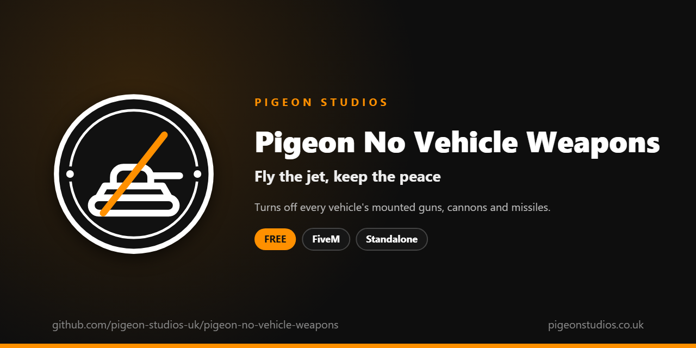

<div align="center">
  

  <h1>Pigeon No Vehicle Weapons</h1>

  <p><strong>Turns off the guns, cannons and missiles built into vehicles, while keeping searchlights and water cannons.</strong></p>

  <p>
    <a href="https://github.com/pigeon-studios-uk/pigeon-no-vehicle-weapons/releases/latest"></a>
    <a href="LICENSE.md"></a>
    <a href="https://discord.gg/2NFVWEUmDF"></a>
    
  </p>

  <p>
    <a href="https://github.com/pigeon-studios-uk/pigeon-no-vehicle-weapons/releases/latest"><strong>Download</strong></a> ·
    <a href="#installation">Install</a> ·
    <a href="#configuration">Configure</a> ·
    <a href="CHANGELOG.md">Changelog</a> ·
    <a href="https://discord.gg/2NFVWEUmDF">Support</a>
  </p>
</div>

---

## Contents

- [Overview](#overview)
- [Features](#features)
- [Requirements](#requirements)
- [Installation](#installation)
- [Updating](#updating)
- [Configuration](#configuration)
- [How it works](#how-it-works)
- [Update checker](#update-checker)
- [Performance](#performance)
- [Security](#security)
- [Troubleshooting](#troubleshooting)
- [FAQ](#faq)
- [Support](#support)
- [Contributing](#contributing)
- [Licence](#licence)
- [Credits](#credits)

## Overview

Pigeon No Vehicle Weapons is a free resource by [Pigeon Studios](https://pigeonstudios.co.uk) that turns off the weapons built into GTA's vehicles: the Lazer's cannon and missiles, the Buzzard's rockets, the Insurgent's and Technical's turrets, the Rhino's main gun, and every other mounted gun. On a roleplay server, one player in an armed jet or a tank can end every scene in seconds.

Players can still use the vehicles. They can fly the jet, drive the tank and sit in the gunner's seat; the guns just don't fire. The helicopter searchlight and the fire truck's water cannon, which GTA also counts as "vehicle weapons", keep working, and you can keep any gun or vehicle you choose.

## Features

- **Every mounted gun off.** Cannons, machine guns, rockets and missiles, in every vehicle that has them, from every seat, gunner seats included.
- **Searchlights and water cannons kept.** The police helicopter's searchlight and the fire truck's water cannon keep working.
- **Keep what you want.** Allow any vehicle weapon by name, or every weapon on a vehicle by its spawn name, including add-on vehicles.
- **The vehicles still work.** Only the weapons are off. Driving and flying are untouched.
- **Weapons players carry untouched.** Drive-bys with guns players carry aren't affected; see [Pigeon Driveby Rules](https://github.com/pigeon-studios-uk/pigeon-driveby-rules) for those.
- **Undoes itself.** Stopping the resource turns the weapons back on.
- **Standalone.** No framework or other resources needed.

## Requirements

| Requirement | Version | Notes |
|---|---|---|
| FXServer | A [recommended artifact](https://runtime.fivem.net/artifacts/) | |

**Frameworks:** none needed. It works the same on standalone and vMenu servers, ESX Legacy, QBCore, Qbox and ox_core.

## Installation

1. **Download** `pigeon-no-vehicle-weapons.zip` from the [latest release](https://github.com/pigeon-studios-uk/pigeon-no-vehicle-weapons/releases/latest). Don't use the green **Code** button; release zips are the tested builds.
2. **Extract** it into your server's `resources` folder. The folder must be called `pigeon-no-vehicle-weapons`.
3. **Start it** by adding this to `server.cfg`:

   ```cfg
   ensure pigeon-no-vehicle-weapons
   ```

4. **Configure** it in `configuration/config.lua` if you want to keep any weapons. The defaults work as they are.
5. **Restart** your server. The console shows one line from the update checker:

   ```text
   [Pigeon Studios] Pigeon No Vehicle Weapons v1.0.0 is up to date.
   ```

## Updating

1. Read the [changelog](CHANGELOG.md) for every version between yours and the latest, especially any **Upgrade notes**.
2. Back up your `configuration/` folder.
3. Replace the `pigeon-no-vehicle-weapons` folder with the new release.
4. Copy your changed settings into the new `configuration/config.lua`. Don't copy the old file over the new one; new versions can add settings.
5. Restart the resource.

## Configuration

All settings are in `configuration/config.lua`, each explained by a comment next to it.

| Setting | Default | What it does |
|---|---|---|
| `Config.AllowedWeapons` | searchlight, water cannon, radar, rotors | Vehicle weapons that stay on, by name |
| `Config.AllowedVehicles` | `{}` | Vehicles that keep every weapon, by spawn name |

**Keeping a weapon.** Vehicle weapons have names such as `VEHICLE_WEAPON_TURRET_INSURGENT` or `VEHICLE_WEAPON_PLAYER_LAZER`. Add the name to `Config.AllowedWeapons` to keep it on everywhere:

```lua
Config.AllowedWeapons = {
    'VEHICLE_WEAPON_SEARCHLIGHT',
    'VEHICLE_WEAPON_WATER_CANNON',
    'VEHICLE_WEAPON_RADAR',
    'VEHICLE_WEAPON_ROTORS',
    'VEHICLE_WEAPON_TURRET_INSURGENT',
}
```

If you replace the list, keep the first four, or the searchlight and water cannon stop working too.

**Keeping a whole vehicle.** Add its spawn name to `Config.AllowedVehicles`, such as `'rhino'` for a tank at an army base event. For an add-on vehicle, the spawn name is the `modelName` in its `vehicles.meta`.

## How it works

While a player is in a vehicle, every frame the resource asks GTA which vehicle weapon they have selected (`GetCurrentPedVehicleWeapon`). If it isn't allowed, and the vehicle isn't either, it turns that weapon off for that player in that vehicle (`DisableVehicleWeapon`). Players can switch between a vehicle's weapons, so each one is turned off as it's selected, once.

This works the same in the driver's seat and in gunner seats. When the resource stops, every weapon it turned off is turned back on.

## Update checker

When it starts, Pigeon No Vehicle Weapons checks our public [version registry](https://github.com/pigeon-studios-uk/pigeon-versions) once and prints one line in the server console saying whether it's up to date. If there's an update, it shows what's new and where to get it. The check is a single request to GitHub and sends nothing about your server or players.

Control it for every Pigeon Studios resource at once in `server.cfg`:

```cfg
set pigeon_update_check "on"      # default: one line per resource
set pigeon_update_check "quiet"   # only when there's an update or a problem
set pigeon_update_check "off"     # never check
```

## Performance

Outside vehicles it checks twice a second and does nothing else. In a vehicle it asks GTA one question every frame, which costs next to nothing. Nothing runs on the server apart from the update check at start-up.

## Security

- It runs only in each player's own game and only changes the vehicle weapons available to that player.
- It has no commands, exports or network events, so there is nothing other players, other resources or the server can send it.
- The only network request is the update check at start-up, from the server to GitHub. It sends nothing about your server or players.
- Like every rule that runs in the player's game, a player with a modified game could get around it. It's a gameplay rule, not an anti-cheat; pair it with your anti-cheat if that matters on your server.

Found a problem? Please don't open a public issue. Use the **Report a vulnerability** button in this repository's **Security** tab, or follow our [Security Policy](https://github.com/pigeon-studios-uk/.github/blob/main/SECURITY.md).

## Troubleshooting

**A vehicle's gun still fires.**
Check the resource is started and there are no errors in the F8 console. Check the vehicle and the weapon aren't in the allowed lists. If it's an add-on vehicle with a scripted weapon (fired by its own resource rather than GTA), that resource has to turn it off.

**The helicopter searchlight stopped working.**
`VEHICLE_WEAPON_SEARCHLIGHT` has to be in `Config.AllowedWeapons`. If you replaced the list, add it back.

**The fire truck's water cannon stopped working.**
`VEHICLE_WEAPON_WATER_CANNON` has to be in `Config.AllowedWeapons`.

**The console says "isn't in the version registry" or "couldn't check for updates".**
Your server couldn't reach GitHub, or the check is blocked by a firewall. The resource works normally either way. Turn the check off with `set pigeon_update_check "off"`.

## FAQ

**Is it really free?**
Yes. Use it on as many servers as you like, including ones that take donations. You just can't reupload, resell or bundle it. See [Licence](#licence).

**Does it work on standalone and vMenu servers?**
Yes. It needs no framework at all. On vMenu servers it works alongside vMenu's vehicle spawner: spawned armed vehicles have their guns off like any other.

**Can players still use the vehicles?**
Yes. Jets fly, tanks drive and helicopters hover. Only the built-in weapons are off.

**Does it stop players shooting from vehicles with their own guns?**
No. That's [Pigeon Driveby Rules](https://github.com/pigeon-studios-uk/pigeon-driveby-rules), or [Pigeon No Weapons In Vehicles](https://github.com/pigeon-studios-uk/pigeon-no-weapons-in-vehicles) to keep weapons holstered in vehicles you choose.

**Does it affect NPCs?**
No. It only changes the vehicle weapons available to players.

## Support

Read [Troubleshooting](#troubleshooting) first, then ask in the support channels of our [Discord](https://discord.gg/2NFVWEUmDF). Please include your Pigeon No Vehicle Weapons version, FXServer artifact, the vehicle and any errors from the console (F8 in game). See [Getting help](https://github.com/pigeon-studios-uk/.github/blob/main/SUPPORT.md).

Found a bug? Open a [bug report](https://github.com/pigeon-studios-uk/pigeon-no-vehicle-weapons/issues/new/choose).

## Contributing

Fixes and improvements are welcome. Please read the [contributing guide](https://github.com/pigeon-studios-uk/.github/blob/main/CONTRIBUTING.md) first, and open a feature request before working on anything big.

## Licence

Pigeon No Vehicle Weapons is free to use under the **[Pigeon Studios Free Licence](LICENSE.md)**.

- ✅ Use it on any number of servers, including monetised ones
- ✅ Change it for your own servers
- ✅ Show it in videos and streams
- ❌ Don't reupload, share or mirror the files; link to this repository instead
- ❌ Don't sell it, bundle it in packs, or put it behind escrow
- ❌ Don't remove the credits

This summary isn't the licence; [LICENSE.md](LICENSE.md) is. Third-party components are listed in [NOTICE.md](NOTICE.md).

## Credits

Made by [Pigeon Studios](https://pigeonstudios.co.uk). Thanks to everyone who has contributed fixes; see the [changelog](CHANGELOG.md).

<sub>Not affiliated with or endorsed by Rockstar Games, Take-Two Interactive or Cfx.re.</sub>
